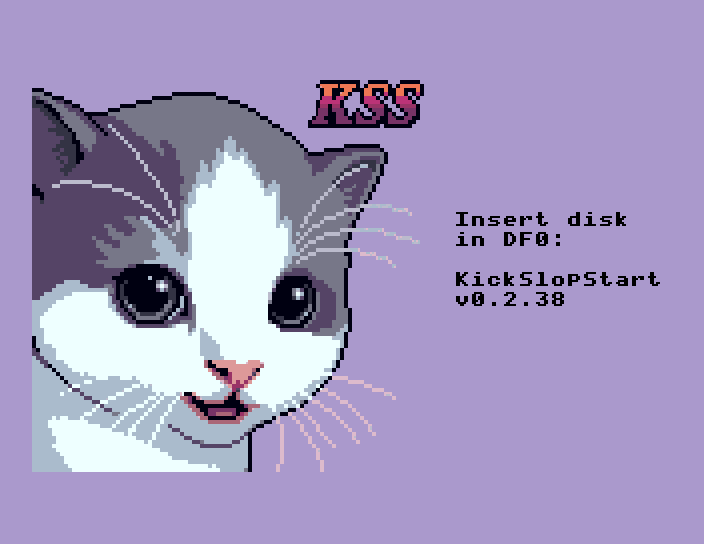

# KickSlopStart — un Kickstart 1.3 en salle blanche pour l'Amiga 500

*[English version](README.md)*

<p align="center"></p>

KickSlopStart est une réimplémentation libre de la ROM **Kickstart 1.3** (34.5) de l'Amiga. Elle est écrite de zéro en
assembleur 68000, selon une méthode de **salle blanche**. L'image fait **256 Kio, chargée à `$FC0000`**, et tourne sur
un simple **68000**, ainsi que sur 68010 ou 68020 (un A1200 émulé démarre le Workbench 1.3, avec l'AGA en mode OCS et
2 Mo de mémoire chip). Elle vise à remplacer directement le Kickstart d'origine sur A500, A1000 et A2000. Elle démarre
en émulateur, et sur un vrai A500 avec la disquette de soft-kick ci-dessous ; le démarrage depuis une EPROM est un
objectif ultérieur.

Ce dépôt ne contient **aucun code de Commodore** et ne fournit **pas** la ROM d'origine. Le code ayant été écrit avec
un LLM qui a pu voir des sources de Kickstart fuitées, cette affirmation est vérifiée par la mesure plutôt que tenue
pour acquise : voir l'[audit clean-room](docs/AUDIT.fr.md) (comparaison binaire avec la ROM 1.3, comparaison des
sources avec AROS, relecture des notes d'analyse, et liste des données de la ROM gardées pour la compatibilité).

## Ce qui fonctionne

Tous les résultats ci-dessous viennent d'un démarrage de la ROM en émulateur (FS-UAE, Amiberry, vAmigaWeb et WinUAE en
mode A500 au cycle près), avec captures d'écran ou sortie série à l'appui.

- **exec** : la table de fonctions V34 complète, un ordonnanceur préemptif, des tâches en mode utilisateur, des
  serveurs d'interruption, des modules résidents, des bibliothèques et des devices, des sémaphores et un allocateur
  mémoire.
- **Devices et ressources** : trackdisk (lecture et écriture, DMA par interruption, lecteurs DF0 interne et DF1
  externe), timer (VBLANK et MICROHZ), keyboard, input, console, gameport (souris), audio, cia, disk, misc, potgo,
  keymap (US et AZERTY), expansion (autoconfig Zorro II), romboot.
- **Graphismes** : graphics.library (views, listes copper, blitter, texte, régions, GELs) et layers.library.
- **Intuition** : écrans, fenêtres au cadre de la 1.3, gadgets (booléens, proportionnels), menus, requesters,
  AutoRequest, Preferences.
- **AmigaDOS** : dos.library avec un runtime BCPL, un handler de système de fichiers OFS (lecture et écriture),
  LoadSeg, le CLI et le shell, RAM:, PIPE:, AUX:, NEWCON:, un validateur de disque, le démarrage sur disque dur
  UAE (DH0:), et les volumes FAT12/16/32 en lecture seule.
- **Workbench 1.3.3** démarre jusqu'au bureau : icônes de disque et de tiroirs, Shell, menus, Info, Duplicate/DiskCopy,
  Clean Up et Preferences fonctionnent.
- **Logiciels testés** : SetPatch 1.38, Ed, SysInfo, Holiday Lemmings (jouable), Caesar, SimCity 1.2, The Secret of
  Monkey Island (disquette 1), Scooby-Doo and Scrappy-Doo.
- **Action Replay MK III** (depuis la v0.2.61) : cartouche branchée, la ROM démarre normalement, le bouton de gel
  ouvre l'écran de la cartouche et `x` revient au programme gelé (testé sous Amiberry, avec et sans slow RAM).
- **HRTMon v2.37** (le freezer intégré à Amiberry/WinUAE) : cartouche activée, la ROM démarre, la touche de gel
  (Pause sous Amiberry, Page Up sous WinUAE) ouvre le moniteur, `x` revient au programme gelé et un reset redémarre
  (testé sous Amiberry et WinUAE).
- **Chipset ECS (A500+)** : la ROM démarre le Workbench 1.3.3 avec une Agnus et une Denise ECS et 1 Mo de chip RAM,
  et traite la machine comme un A500 OCS, comme la 1.3 : aucun registre ECS n'est écrit, et la chip RAM est détectée
  jusqu'à 2 Mo (testé sous Amiberry).

Les manques connus et la feuille de route détaillée sont dans [`docs/PLAN.md`](docs/PLAN.md).

## Différences voulues (pas des bugs)

Certaines choses diffèrent volontairement du Kickstart 1.3 d'origine. Merci de ne pas les signaler comme des bugs
(voir l'[issue #5](https://github.com/Thaolia/KickSlopStart/issues/5)) :

- **Couleurs** : l'écran du Workbench prend une palette à la CDE (fond violet Sun/Solaris, crème, texte noir, bleu
  ardoise) au lieu du bleu de la 1.3, comme proposé dans l'[issue #24](https://github.com/Thaolia/KickSlopStart/issues/24).
  Elle montre d'un coup d'œil quel Kickstart tourne.
- **Écran « insérez une disquette »** : à la place de la main qui tient une disquette, le logo chaton de KSS, parce
  que j'aime les chats, avec « Insert disk in DF0: » et le numéro de build de la ROM à côté. Voici une capture de
  l'écran tel que la ROM le dessine (généré depuis `assets/boot_screen/kss_logo.svg` par
  `src/graphics/mk_bootscreen.py`) :

  <p align="center"></p>

- **Menus** : la coche est une empreinte de patte de chat, et le symbole de la touche Amiga des raccourcis clavier est
  un petit chat.
- **Fenêtre de démarrage** : la fenêtre du CLI de boot s'appelle « AmigaSlopDOS ».
- **Pointeur de souris** : le pointeur propre à la ROM est une autre flèche que l'original, remplie de mauve
  au lieu de rouge. Une disquette Workbench affiche toujours le pointeur de son `devs:system-configuration`, comme
  sur la 1.3 d'origine.

## Diagnostic au démarrage

Lors d'un démarrage à froid (mise sous tension, ou reset qui n'a pas gardé un ExecBase valide), KickSlopStart teste la
machine avant de construire exec et affiche le résultat en **texte**, là où les Kickstart suivants font clignoter une
couleur. La vraie 1.3 n'en fait presque rien : elle vérifie seulement qu'il y a 256 Ko de chip RAM (écran vert
sinon) et intercepte les exceptions CPU précoces (écran jaune). Les tests, dans l'ordre :

| Ligne à l'écran | Ce qui est vérifié |
|---|---|
| `Chip RAM   data, address, cells` | taille (512 Ko au moins, jusqu'à 2 Mo), les 32 lignes de données, les lignes d'adresse, un long tous les 256 octets avec deux motifs ; chaque long est remis en place |
| `Agnus      beam counter` | la position verticale du faisceau avance |
| `Agnus      blitter` | deux blits d'un mot arrivent en chip RAM et le blitter termine |
| `Paula      INTENA, ADKCON` | les deux registres relisent deux motifs de bits |
| `CIA-A`/`CIA-B timer A` | le timer A décompte |
| `ROM        checksum` | les 65 536 longs de l'image font `$FFFFFFFF` (retenue reportée) |

L'écran texte apparaît dès que la chip RAM est validée (il est logé dedans) et disparaît quand tous les tests
passent, environ un quart de seconde plus tard (estimation tirée du nombre d'instructions, surtout la somme de la ROM).
Si un test échoue, l'écran reste, la diode d'alimentation clignote et le **bouton gauche de la souris redémarre** la
machine. La panne est aussi écrite sur le port série (environ 9600 bauds), à regarder quand rien ne peut s'afficher.

La couleur du fond indique la catégorie de la première panne. Avec une panne de chip RAM, il n'y a pas de RAM pour
dessiner du texte : seule la couleur s'affiche. Les couleurs sont choisies pour ne jamais être confondues avec le code
officiel (gris foncé, gris clair, rouge = ROM, vert = chip RAM, bleu = puces custom, jaune = exception CPU, blanc) :

| Couleur | Signification |
|---|---|
| nuances de violet sombre (`$213`, `$324`, `$435`, `$326`) | démarrage en cours / tests réussis |
| **magenta** `$F0F` | panne de chip RAM, ou moins de 512 Ko (pas de texte : couleur et port série seulement) |
| **orange** `$F80` | Agnus, Paula ou un CIA en panne |
| **violet** `$70E` | somme de contrôle de la ROM fausse (image abîmée ou modifiée) |
| **turquoise** `$0DD` | exception CPU avant qu'exec soit prêt ; l'écran donne le vecteur, le PC et le SR |

Denise n'est pas testé : sur une machine OCS, son seul registre lisible est celui des collisions de sprites et de
playfields, qui demande un affichage en marche ; un écran texte lisible est son test. Le diagnostic ne tourne pas après un reset à chaud qui garde ExecBase (soft-kick, programmes KickTag,
disques RAM résistants au reset), car ses tests de RAM écraseraient ce que ce reset conserve.

## Essayer dans le navigateur

**[Lancer KickSlopStart dans vAmigaWeb](https://vamigaweb.github.io/#%7B%22kickstart_rom_url%22%3A%22https%3A%2F%2Fraw.githubusercontent.com%2FThaolia%2FKickSlopStart%2From%2FKickSlopStart.rom%22%2C%22mouse%22%3Atrue%2C%22startup_script%22%3A%22%28function%20t%28%29%7Btry%7Bif%28%21required_roms_loaded%29throw%200%3Bset_activity_monitor%28true%29%3Bset_memview_enabled%28true%29%3Bmemview_open_panel%28%29%3B%7Dcatch%28e%29%7BsetTimeout%28t%2C500%29%3B%7D%7D%29%28%29%3B%22%7D)** : l'émulateur Amiga du navigateur démarre avec la dernière ROM publiée
au lieu de la sienne. Sans disquette, il s'arrête sur l'écran d'insertion ; insérez votre propre ADF depuis le menu
disquette de vAmigaWeb ou en la déposant sur la fenêtre. Le lien passe la ROM par le réglage `kickstart_rom_url` de
vAmigaWeb (`https://vamigaweb.github.io/#{"kickstart_rom_url":"…"}`, encodé) ; il met aussi la souris sur le port
de jeu 1 (`"mouse":true`) et, par un `startup_script`, active le moniteur d'activité et ouvre la vue mémoire en direct
dès que l'émulateur tourne. La ROM vient de la branche `rom`
(`KickSlopStart.rom`), que le workflow de release met à jour à chaque tag : le navigateur ne laisse vAmigaWeb charger
qu'un fichier servi avec un en-tête CORS, ce que fait `raw.githubusercontent.com` et pas le téléchargement des releases.

## Téléchargement

Des images ROM prêtes à l'emploi sont publiées sur la page [Releases](https://github.com/Thaolia/KickSlopStart/releases).
Chaque image est construite depuis les sources du tag par un workflow GitHub (`.github/workflows/release.yml`, toolchain
épinglée) : elle est identique à l'octet à un `make kick-prod` local du même commit, et son SHA-256 figure dans les notes
de la release, avec les commits depuis la release précédente.

## Disquette de soft-kick (sans changer de ROM)

**Minimum : 512 Kio de chip RAM plus 512 Kio de slow RAM, ou 1 Mio de fast RAM Zorro II, ou 1 Mio de chip RAM.** La disquette de soft-kick démarre
KickSlopStart sur une machine qui garde son propre Kickstart en ROM (1.3, ou 2.x/3.x). Chaque release fournit
`KickSlopStart-<version>.adf`, et la branche `rom` porte la dernière sous le nom
[`KickSlopStart.adf`](https://raw.githubusercontent.com/Thaolia/KickSlopStart/rom/KickSlopStart.adf). Pour la
construire : `make adf` (`build/KickSlopStart.adf`).

### Utilisation

Bootez la disquette sur le Kickstart de la machine : son bootblock charge KickSlopStart (256 Kio) et le démarre.
KickSlopStart affiche alors son écran d'insertion : retirez la disquette de soft-kick, insérez celle que vous voulez,
et il la boote. Un reset (Ctrl+Amiga+Amiga) revient sur KickSlopStart, grâce au vecteur ColdCapture que le Kickstart
en ROM appelle au reset ; éteindre la machine ramène au Kickstart en ROM. Sans assez de fast RAM, de slow RAM ni de
chip RAM, la disquette boote normalement sur le Kickstart en ROM.

### Fast RAM Zorro II (premier choix)

Quand une carte autoconfig fournit de la fast RAM Zorro II (`$200000`-`$9FFFFF` : une carte mémoire d'A500/A2000,
une carte de trappe d'A600 ou d'A1200), la disquette y installe KickSlopStart, tout en haut. Un reset déconfigure ces
cartes : la disquette les enregistre donc aussi en bas de la chip RAM, et un petit relais à cet endroit leur rend
leurs adresses avant d'entrer dans KickSlopStart. L'image prend 256 Kio de la carte ; la chip et la slow RAM restent
libres pour les programmes.

- Testée en émulation (Amiberry) sur un A500 (2 Mio de fast, avec et sans slow RAM), un A600 (1 Mio de chip, 2 Mio
  de fast) et un A1200 en 68020, 68030 et 68040 (2 Mio de chip, 4 Mio de fast) : premier démarrage, reset
  Ctrl+Amiga+Amiga qui revient dans KickSlopStart, Workbench 1.3.3, avec KickSlopStart lui-même et avec des
  Kickstart Commodore comme hôte (1.3 sur l'A500, 2.05 sur l'A600, 3.0 et 3.1 sur l'A1200,
  [docs/analysis/softkick-fast-real-host.md](docs/analysis/softkick-fast-real-host.md)). Pas encore essayée sur du
  vrai matériel, les retours sont bienvenus.
- Cartes Zorro II seulement, 8 au plus. Avec une carte Zorro III (configurée par un Kickstart 2.x/3.x), la
  disquette se rabat sur la slow ou la chip RAM ; les cartes Zorro II restent utilisables, mais après un reset la
  carte Zorro III reste non configurée et cache toute carte placée derrière elle. Testée avec jusqu'à trois cartes de RAM, une carte de RAM avec une carte Ethernet, et une carte mise hors
  bus faute de place.

### A500 avec slow RAM

Quand la slow RAM couvre `$C00000` (un A500 avec son extension A501 dans la trappe), la disquette y installe
KickSlopStart. Il prend les 256 premiers Kio de la slow RAM et le reste reste disponible ; la chip RAM n'est pas
touchée. Testée sur un vrai A500.

### A1200, ou A500 avec 1 Mio de chip RAM (à la manière de Relokick)

Sans slow RAM, la disquette reloge KickSlopStart dans la chip RAM au-dessus de 512 Kio, aussi haut qu'un bloc libre
aligné sur 64 Kio le permet (un Kickstart 2.x/3.x garde sa pile superviseur tout en haut, donc l'image se place en
général 64 Kio plus bas). Ça couvre un A500 avec un Agnus 1 Mio et un A1200, qui n'a jamais de slow RAM. L'image
prend 256 Kio de la chip utilisable par les programmes : il reste environ 600 Kio libres au Workbench avec 1 Mio de
chip, environ 1,6 Mio avec 2 Mio.

- Testée en émulation (Amiberry, WinUAE, cycle-exact ou non) avec un vrai Kickstart 1.3 (1 Mio de chip, 68000), le
  Kickstart 2.05 de l'A600 (68000, 1 Mio de chip, ECS), le Kickstart 3.0 de l'A1200 (68EC020, 2 Mio de chip, AGA)
  et un Kickstart 3.1 ; pas encore essayée sur un vrai A600 ou A1200, les retours sont bienvenus.
- 68060 : démarre en émulation (Kickstart 3.0/3.1 et KickSlopStart comme hôte), vu par exec comme un 68020 sans
  FPU. MapROM des cartes accélératrices non pris en charge. Sur un 68040, la disquette coupe les caches et la MMU
  qu'un Kickstart 2.x/3.x a pu laisser actifs.
- Le disque dur IDE interne d'un A600/A1200 est monté ([docs/IDE-HARDDISK.fr.md](docs/IDE-HARDDISK.fr.md)) : les
  partitions RDB en lecture et en écriture, les cartes FAT12/16/32 formatées sur PC en lecture seule ; le PCMCIA
  n'est pas pris en charge. Les machines AGA tournent en mode OCS, comme sous une vraie 1.3.

### Relokick, MKick, SKick

Ces outils de soft-kick ne peuvent pas démarrer KickSlopStart : ils sont faits pour charger des fichiers Kickstart de
Commodore avec des données de patch ou de relocation construites pour chaque ROM Commodore exacte (SKick compare la
somme de contrôle de la ROM à ses propres tables, MKick ne démarre pas de Kickstart 1.3, Relokick fournit sa propre
1.3 patchée). Utilisez plutôt la disquette de soft-kick : elle porte sa propre table de relocation, construite depuis
nos sources (`src/softkick/mkreloc.py`). Relokick lui-même ne reconfigure jamais la RAM autoconfig après un reset,
c'est pourquoi il place sa copie en chip ou en slow RAM
([docs/analysis/relokick-v34.md](docs/analysis/relokick-v34.md)).

## Signaler un problème

Les signalements de bugs et d'incompatibilités sont les bienvenus en [issues GitHub](https://github.com/Thaolia/KickSlopStart/issues/new/choose).
Le [guide de signalement](docs/ISSUE.fr.md) dit quoi indiquer (version de la ROM, émulateur et configuration
mémoire, programme, capture d'écran) et ce qu'il ne faut jamais joindre (la ROM d'origine, son désassemblage, du
code Commodore).

## Pourquoi ce projet, et le réutiliser

Pour moi, c'est un **projet éducatif** : une façon d'apprendre le fonctionnement interne d'AmigaOS 1.3, et de voir
jusqu'où peut aller une réimplémentation en salle blanche écrite avec un LLM, quand chaque étape doit être prouvée en
émulateur.

Vous êtes libres de le reprendre pour **faire votre propre Kickstart**. Changez les couleurs, remplacez le chat par
votre animal, ajoutez des fonctions ou améliorez la compatibilité. Le code est sous licence MIT, et les outils d'audit
de salle blanche de `tests/` vous permettent de vérifier vos propres modifications de la même façon.

## Méthode de salle blanche

Le travail est séparé en deux pistes qui ne se mélangent jamais (voir [`docs/CLEANROOM.md`](docs/CLEANROOM.md)) :

- **Piste analyse** : observe la ROM d'origine (désassemblage, sondes, débogueur) et n'écrit **que des descriptions
  de comportement et d'ABI** dans [`docs/analysis/`](docs/analysis/). Aucune suite d'instructions n'est recopiée.
- **Piste implémentation** : écrit `src/` à partir de la documentation publique (RKRM, NDK, AutoDocs, fichiers `.fd`),
  d'AROS en simple lecture, et des spécifications de la piste analyse. Elle ne lit jamais la ROM ni son
  désassemblage.

## Identifier la ROM

Les émulateurs et outils peuvent reconnaître n'importe quelle image KickSlopStart sans liste de hashes, sauf les
anciennes releases (v0.2.10 et avant n'ont pas de bloc d'identification). Ce format est stable :

| Offset | Octets | Contenu |
|---|---|---|
| `$0C` | 4 | `$0022 $0005` : version 34.5, comme sur le Kickstart 1.3 (des programmes la vérifient ; ce n'est pas notre numéro de release) |
| `$18` | 4 | ASCII `KSS!` : l'empreinte |
| `$1C` | 64 | chaîne ASCII terminée par un zéro, par exemple `KickSlopStart v0.2.11` : le tag de la release, ou le hash court du commit pour un build hors tag (`git describe` pour un build local) |

Le même bloc se trouve au début de l'image sur la disquette de soft-kick. Le reste de l'en-tête et le checksum sont
ceux d'un Kickstart 256 Ko ordinaire.

## Compilation

Outils requis, tous dans le `PATH` :

- `vasmm68k_mot` et `vlink` (assembleur et éditeur de liens de Frank Wille, compilés depuis les sources)
- `romtool` (fourni par [amitools](https://github.com/cnvogelg/amitools))
- `python3`

Les instructions d'installation sont dans [`docs/HARDWARE.md`](docs/HARDWARE.md).

```sh
make             # build/kick13.rom       ROM de développement (avec le harnais d'auto-test)
make kick-prod   # build/kick13-prod.rom  ROM de production (-DPROD=1, sans harnais de test ni copie de la console sur le port série)
make verify      # vérifie la taille (256 Kio) et que romtool donne is_kick = ok
make adf         # build/KickSlopStart.adf disquette de soft-kick (image liée en $C00000 + table de relocation, -DRAMKICK=1)
make kick-a1200  # build/kick13-a1200.rom image de 512 Kio pour le support ROM d'un A1200/A4000 (la ROM de production deux fois)
```

Pour un usage courant en émulateur, prendre `build/kick13-prod.rom`. La ROM de développement lance aussi des tâches
de démonstration et des sondes de test au démarrage.

Pour un clavier AZERTY, mettre `KEYMAP_AZERTY` à 1 dans `src/exec/exec.i` avant de compiler.

## Tests

Les tests démarrent la ROM sans affichage (sous Xvfb) et vérifient des marqueurs série ou des captures d'écran. Il faut
`fs-uae`, `Xvfb`, `socat`, `xwd` et ImageMagick.

```sh
tests/boot_test.sh                       # démarre FS-UAE et vérifie le journal série
WINUAE=/chemin/vers/AppRun tests/adf_suite_winuae.sh build/kick13-prod.rom 120
                                         # démarre chaque ADF de assets/test_adf/ sous WinUAE (A500 au cycle près)
```

`tests/adf_suite_winuae.sh` cherche WinUAE dans la variable `WINUAE`, ou sous le nom `winuae` dans le `PATH`. Les
images de disquettes sont à fournir soi-même ; elles ne sont pas incluses.

## Organisation du dépôt

```
src/exec/        exec.library, devices et ressources
src/graphics/    graphics.library, layers.library, écran de démarrage
src/intuition/   intuition.library
src/dos/         dos.library, handlers, CLI/shell, Workbench
src/rom/         assemblage de l'image (remplissage, pied, somme de contrôle) et la hello-ROM M0
src/softkick/    disquette de soft-kick : bootblock chargeur, construction de la table de relocation et de l'ADF
docs/            plan, architecture, matériel et outils, règles de salle blanche
docs/analysis/   spécifications écrites par la piste analyse
tests/           harnais d'émulation et programmes de test
assets/          image de l'écran de démarrage ; votre ROM et vos ADF vont ici (ignorés par git)
```

## Aspects juridiques

- La ROM Kickstart d'origine est protégée par le droit d'auteur. Elle n'est **pas** incluse et ne doit jamais être
  commitée. Pour l'analyse et la comparaison, placez votre propre copie de `kick34005.A500` dans `assets/` ; elle est
  ignorée par git.
- Les images de disquettes de jeux et du Workbench ne sont pas incluses non plus.
- AROS sert uniquement de référence ; aucun de ses fichiers n'est copié dans `src/` (mesuré dans
  [docs/audit/aros-similarity.md](docs/audit/aros-similarity.md)).
- Amiga est une marque de son propriétaire respectif. Ce projet n'y est pas affilié.

## Licence

Le code de ce dépôt est publié sous [licence MIT](LICENSE). Elle ne couvre que les fichiers de ce dépôt et ne donne
aucun droit sur la ROM Kickstart d'origine, sur AmigaOS ni sur une image de disquette.
