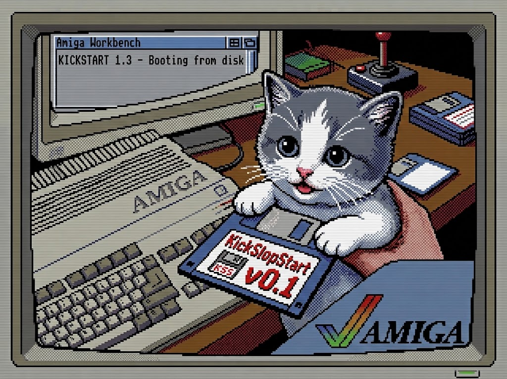

# KickSlopStart — un Kickstart 1.3 en salle blanche pour l'Amiga 500

*[English version](README.md)*

<p align="center"></p>

KickSlopStart est une réimplémentation libre de la ROM **Kickstart 1.3** (34.5) de l'Amiga. Elle est écrite de zéro en
assembleur 68000, selon une méthode de **salle blanche**. L'image fait **256 Kio, chargée à `$FC0000`**, et tourne sur
un simple **68000**. Elle vise à remplacer directement le Kickstart d'origine sur A500, A1000 et A2000. Elle démarre
aujourd'hui en émulateur ; le démarrage sur un vrai A500 depuis une EPROM est un objectif ultérieur.

Ce dépôt ne contient **aucun code de Commodore** et ne fournit **pas** la ROM d'origine. Le code ayant été écrit avec
un LLM qui a pu voir des sources de Kickstart fuitées, cette affirmation est vérifiée par la mesure plutôt que tenue
pour acquise : voir l'[audit clean-room](docs/AUDIT.fr.md) (comparaison binaire avec la ROM 1.3, comparaison des
sources avec AROS, relecture des notes d'analyse, et liste des données de la ROM gardées pour la compatibilité).

## Téléchargement

Des images ROM prêtes à l'emploi sont publiées sur la page [Releases](https://github.com/Thaolia/KickSlopStart/releases).
Chaque image est construite depuis les sources du tag par un workflow GitHub (`.github/workflows/release.yml`, toolchain
épinglée) : elle est identique à l'octet à un `make kick-prod` local du même commit, et son SHA-256 figure dans les notes
de la release. Pour publier une nouvelle release, pousser un tag : `git tag v0.1.0 && git push origin v0.1.0`.

## Ce qui fonctionne

Tous les résultats ci-dessous viennent d'un démarrage de la ROM en émulateur (FS-UAE, et WinUAE en mode A500 au cycle
près), avec captures d'écran ou sortie série à l'appui.

- **exec** : la table de fonctions V34 complète, un ordonnanceur préemptif, des tâches en mode utilisateur, des
  serveurs d'interruption, des modules résidents, des bibliothèques et des devices, des sémaphores et un allocateur
  mémoire.
- **Devices et ressources** : trackdisk (lecture et écriture, DMA par interruption), timer (VBLANK et MICROHZ),
  keyboard, input, console, gameport (souris), audio, cia, disk, misc, potgo, keymap (US et AZERTY), expansion
  (autoconfig Zorro II), romboot.
- **Graphismes** : graphics.library (views, listes copper, blitter, texte, régions, GELs) et layers.library.
- **Intuition** : écrans, fenêtres au cadre de la 1.3, gadgets (booléens, proportionnels), menus, requesters,
  AutoRequest, Preferences.
- **AmigaDOS** : dos.library avec un runtime BCPL, un handler de système de fichiers OFS (lecture et écriture),
  LoadSeg, le CLI et le shell, RAM:, PIPE:, AUX:, NEWCON:, un validateur de disque, et le démarrage sur disque dur
  UAE (DH0:).
- **Workbench 1.3.3** démarre jusqu'au bureau : icônes de disque et de tiroirs, Shell, menus, Info, Duplicate/DiskCopy,
  Clean Up et Preferences fonctionnent.
- **Logiciels testés** : SetPatch 1.38, SysInfo, Holiday Lemmings (jouable), Caesar, SimCity 1.2, The Secret of
  Monkey Island (disquette 1), Scooby-Doo and Scrappy-Doo.

Les manques connus et la feuille de route détaillée sont dans [`docs/PLAN.md`](docs/PLAN.md).

## Méthode de salle blanche

Le travail est séparé en deux pistes qui ne se mélangent jamais (voir [`docs/CLEANROOM.md`](docs/CLEANROOM.md)) :

- **Piste analyse** : observe la ROM d'origine (désassemblage, sondes, débogueur) et n'écrit **que des descriptions
  de comportement et d'ABI** dans [`docs/analysis/`](docs/analysis/). Aucune suite d'instructions n'est recopiée.
- **Piste implémentation** : écrit `src/` à partir de la documentation publique (RKRM, NDK, AutoDocs, fichiers `.fd`),
  d'AROS en simple lecture, et des spécifications de la piste analyse. Elle ne lit jamais la ROM ni son
  désassemblage.

## Compilation

Outils requis, tous dans le `PATH` :

- `vasmm68k_mot` et `vlink` (assembleur et éditeur de liens de Frank Wille, compilés depuis les sources)
- `romtool` (fourni par [amitools](https://github.com/cnvogelg/amitools))
- `python3`

Les instructions d'installation sont dans [`docs/HARDWARE.md`](docs/HARDWARE.md).

```sh
make             # build/kick13.rom       ROM de développement (avec le harnais d'auto-test)
make kick-prod   # build/kick13-prod.rom  ROM de production (-DPROD=1, sans harnais de test)
make verify      # vérifie la taille (256 Kio) et que romtool donne is_kick = ok
```

Pour un usage courant en émulateur, prendre `build/kick13-prod.rom`. La ROM de développement lance aussi des tâches
de démonstration et des sondes de test au démarrage.

Pour un clavier AZERTY, mettre `KEYMAP_AZERTY` à 1 dans `src/exec/exec.i` avant de compiler.

## Tests

Les tests démarrent la ROM sans affichage (sous Xvfb) et vérifient des marqueurs série ou des captures d'écran. Il faut
`fs-uae`, `Xvfb`, `socat`, `xwd` et ImageMagick.

```sh
tests/boot_test.sh                       # démarre FS-UAE et vérifie le journal série
WINUAE=/chemin/vers/AppRun tests/adf_suite_winuae.sh build/kick13-prod.rom 120
                                         # démarre chaque ADF de assets/test_adf/ sous WinUAE (A500 au cycle près)
```

`tests/adf_suite_winuae.sh` cherche WinUAE dans la variable `WINUAE`, ou sous le nom `winuae` dans le `PATH`. Les
images de disquettes sont à fournir soi-même ; elles ne sont pas incluses.

## Organisation du dépôt

```
src/exec/        exec.library, devices et ressources
src/graphics/    graphics.library, layers.library, écran de démarrage
src/intuition/   intuition.library
src/dos/         dos.library, handlers, CLI/shell, Workbench
src/rom/         assemblage de l'image (remplissage, pied, somme de contrôle) et la hello-ROM M0
docs/            plan, architecture, matériel et outils, règles de salle blanche
docs/analysis/   spécifications écrites par la piste analyse
tests/           harnais d'émulation et programmes de test
assets/          image de l'écran de démarrage ; votre ROM et vos ADF vont ici (ignorés par git)
```

## Aspects juridiques

- La ROM Kickstart d'origine est protégée par le droit d'auteur. Elle n'est **pas** incluse et ne doit jamais être
  commitée. Pour l'analyse et la comparaison, placez votre propre copie de `kick34005.A500` dans `assets/` ; elle est
  ignorée par git.
- Les images de disquettes de jeux et du Workbench ne sont pas incluses non plus.
- AROS sert uniquement de référence ; aucun de ses fichiers n'est copié dans `src/` (mesuré dans
  [docs/audit/aros-similarity.md](docs/audit/aros-similarity.md)).
- Amiga est une marque de son propriétaire respectif. Ce projet n'y est pas affilié.

## Licence

Le code de ce dépôt est publié sous [licence MIT](LICENSE). Elle ne couvre que les fichiers de ce dépôt et ne donne
aucun droit sur la ROM Kickstart d'origine, sur AmigaOS ni sur une image de disquette.
