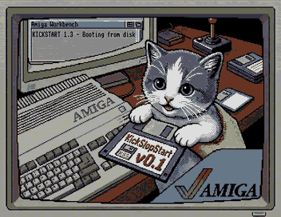

# KickSlopStart — un Kickstart 1.3 en salle blanche pour l'Amiga 500

*[English version](README.md)*

<p align="center"></p>

KickSlopStart est une réimplémentation libre de la ROM **Kickstart 1.3** (34.5) de l'Amiga. Elle est écrite de zéro en
assembleur 68000, selon une méthode de **salle blanche**. L'image fait **256 Kio, chargée à `$FC0000`**, et tourne sur
un simple **68000**. Elle vise à remplacer directement le Kickstart d'origine sur A500, A1000 et A2000. Elle démarre
en émulateur, et sur un vrai A500 avec la disquette de soft-kick ci-dessous ; le démarrage depuis une EPROM est un
objectif ultérieur.

Ce dépôt ne contient **aucun code de Commodore** et ne fournit **pas** la ROM d'origine. Le code ayant été écrit avec
un LLM qui a pu voir des sources de Kickstart fuitées, cette affirmation est vérifiée par la mesure plutôt que tenue
pour acquise : voir l'[audit clean-room](docs/AUDIT.fr.md) (comparaison binaire avec la ROM 1.3, comparaison des
sources avec AROS, relecture des notes d'analyse, et liste des données de la ROM gardées pour la compatibilité).

## Téléchargement

Des images ROM prêtes à l'emploi sont publiées sur la page [Releases](https://github.com/Thaolia/KickSlopStart/releases).
Chaque image est construite depuis les sources du tag par un workflow GitHub (`.github/workflows/release.yml`, toolchain
épinglée) : elle est identique à l'octet à un `make kick-prod` local du même commit, et son SHA-256 figure dans les notes
de la release. Pour publier une nouvelle release, pousser un tag : `git tag v0.1.0 && git push origin v0.1.0`.

## Identifier la ROM

Les émulateurs et outils peuvent reconnaître n'importe quelle image KickSlopStart sans liste de hashes, sauf les
anciennes releases (v0.2.10 et avant n'ont pas de bloc d'identification). Ce format est stable :

| Offset | Octets | Contenu |
|---|---|---|
| `$0C` | 4 | `$0022 $0005` : version 34.5, comme sur le Kickstart 1.3 (des programmes la vérifient ; ce n'est pas notre numéro de release) |
| `$18` | 4 | ASCII `KSS!` : l'empreinte |
| `$1C` | 64 | chaîne ASCII terminée par un zéro, par exemple `KickSlopStart v0.2.11` : le tag de la release, ou le hash court du commit pour un build hors tag (`git describe` pour un build local) |

Le même bloc se trouve au début de l'image sur la disquette de soft-kick. Le reste de l'en-tête et le checksum sont
ceux d'un Kickstart 256 Ko ordinaire.

## Essayer dans le navigateur

**[Lancer KickSlopStart dans vAmigaWeb](https://vamigaweb.github.io/#%7B%22kickstart_rom_url%22%3A%22https%3A%2F%2Fraw.githubusercontent.com%2FThaolia%2FKickSlopStart%2From%2FKickSlopStart.rom%22%2C%22mouse%22%3Atrue%2C%22startup_script%22%3A%22%28function%20t%28%29%7Btry%7Bif%28%21required_roms_loaded%29throw%200%3Bset_activity_monitor%28true%29%3Bset_memview_enabled%28true%29%3Bmemview_open_panel%28%29%3B%7Dcatch%28e%29%7BsetTimeout%28t%2C500%29%3B%7D%7D%29%28%29%3B%22%7D)** : l'émulateur Amiga du navigateur démarre avec la dernière ROM publiée
au lieu de la sienne. Sans disquette, il s'arrête sur l'écran d'insertion ; insérez votre propre ADF depuis le menu
disquette de vAmigaWeb ou en la déposant sur la fenêtre. Le lien passe la ROM par le réglage `kickstart_rom_url` de
vAmigaWeb (`https://vamigaweb.github.io/#{"kickstart_rom_url":"…"}`, encodé) ; il met aussi la souris sur le port
de jeu 1 (`"mouse":true`) et, par un `startup_script`, active le moniteur d'activité et ouvre la vue mémoire en direct
dès que l'émulateur tourne. La ROM vient de la branche `rom`
(`KickSlopStart.rom`), que le workflow de release met à jour à chaque tag : le navigateur ne laisse vAmigaWeb charger
qu'un fichier servi avec un en-tête CORS, ce que fait `raw.githubusercontent.com` et pas le téléchargement des releases.

## Disquette de soft-kick (sans changer de ROM)

**Minimum : 512 Kio de chip RAM + 512 Kio de slow RAM** (un A500 avec son extension A501 dans la trappe). Sans slow
RAM, le `.adf` ne peut pas lancer KickSlopStart, qui s'y installe. Testée sur un vrai A500.

Chaque release fournit aussi `KickSlopStart-<version>.adf`, et la branche `rom` porte la dernière sous le nom
[`KickSlopStart.adf`](https://raw.githubusercontent.com/Thaolia/KickSlopStart/rom/KickSlopStart.adf). Bootez-la sur un
Amiga 500 qui garde son Kickstart 1.3 et dispose de 512 Kio de slow RAM en `$C00000` (extension A501 de la trappe) :
son bootblock charge KickSlopStart dans les 256 premiers Kio de cette RAM et le démarre ; le reste de la slow RAM reste
disponible. KickSlopStart affiche alors son écran d'insertion : retirez la disquette de soft-kick, insérez celle que
vous voulez, et il la boote. Un reset (Ctrl+Amiga+Amiga) revient sur KickSlopStart, grâce au vecteur ColdCapture que le Kickstart en
ROM appelle au reset ; éteindre la machine ramène au Kickstart en ROM. Sans slow RAM, la disquette boote normalement
sur le Kickstart en ROM. Pour la construire : `make adf` (`build/KickSlopStart.adf`).

## Ce qui fonctionne

Tous les résultats ci-dessous viennent d'un démarrage de la ROM en émulateur (FS-UAE, et WinUAE en mode A500 au cycle
près), avec captures d'écran ou sortie série à l'appui.

- **exec** : la table de fonctions V34 complète, un ordonnanceur préemptif, des tâches en mode utilisateur, des
  serveurs d'interruption, des modules résidents, des bibliothèques et des devices, des sémaphores et un allocateur
  mémoire.
- **Devices et ressources** : trackdisk (lecture et écriture, DMA par interruption, lecteurs DF0 interne et DF1
  externe), timer (VBLANK et MICROHZ), keyboard, input, console, gameport (souris), audio, cia, disk, misc, potgo,
  keymap (US et AZERTY), expansion (autoconfig Zorro II), romboot.
- **Graphismes** : graphics.library (views, listes copper, blitter, texte, régions, GELs) et layers.library.
- **Intuition** : écrans, fenêtres au cadre de la 1.3, gadgets (booléens, proportionnels), menus, requesters,
  AutoRequest, Preferences.
- **AmigaDOS** : dos.library avec un runtime BCPL, un handler de système de fichiers OFS (lecture et écriture),
  LoadSeg, le CLI et le shell, RAM:, PIPE:, AUX:, NEWCON:, un validateur de disque, et le démarrage sur disque dur
  UAE (DH0:).
- **Workbench 1.3.3** démarre jusqu'au bureau : icônes de disque et de tiroirs, Shell, menus, Info, Duplicate/DiskCopy,
  Clean Up et Preferences fonctionnent.
- **Logiciels testés** : SetPatch 1.38, Ed, SysInfo, Holiday Lemmings (jouable), Caesar, SimCity 1.2, The Secret of
  Monkey Island (disquette 1), Scooby-Doo and Scrappy-Doo.

Les manques connus et la feuille de route détaillée sont dans [`docs/PLAN.md`](docs/PLAN.md).

## Différences voulues (pas des bugs)

Certaines choses diffèrent volontairement du Kickstart 1.3 d'origine. Merci de ne pas les signaler comme des bugs
(voir l'[issue #5](https://github.com/Thaolia/KickSlopStart/issues/5)) :

- **Couleurs** : l'écran du Workbench est vert pomme avec du texte noir au lieu du bleu. J'aime cette couleur, et elle
  montre d'un coup d'œil quel Kickstart tourne.
- **Écran de démarrage** : à la place de la main qui tient une disquette, un chaton tient une disquette
  « KickSlopStart », parce que j'aime les chats. Voici l'image telle que la ROM la dessine (la photo en haut de cette
  page est l'illustration d'origine) :

  <p align="center"></p>

- **Menus** : la coche est une empreinte de patte de chat, et le symbole de la touche Amiga des raccourcis clavier est
  un petit chat.
- **Fenêtre de démarrage** : la fenêtre du CLI de boot s'appelle « AmigaSlopDOS ».
- **Pointeur de souris** : le pointeur propre à la ROM est une autre flèche que l'original, remplie de violet sombre
  au lieu de rouge. Une disquette Workbench affiche toujours le pointeur de son `devs:system-configuration`, comme
  sur la 1.3 d'origine.

## Signaler un problème

Les signalements de bugs et d'incompatibilités sont les bienvenus en [issues GitHub](https://github.com/Thaolia/KickSlopStart/issues/new/choose).
Le [guide de signalement](docs/ISSUE.fr.md) dit quoi indiquer (version de la ROM, émulateur et configuration
mémoire, programme, capture d'écran) et ce qu'il ne faut jamais joindre (la ROM d'origine, son désassemblage, du
code Commodore).

## Pourquoi ce projet, et le réutiliser

Pour moi, c'est un **projet éducatif** : une façon d'apprendre le fonctionnement interne d'AmigaOS 1.3, et de voir
jusqu'où peut aller une réimplémentation en salle blanche écrite avec un LLM, quand chaque étape doit être prouvée en
émulateur.

Vous êtes libres de le reprendre pour **faire votre propre Kickstart**. Changez les couleurs, remplacez le chat par
votre animal, ajoutez des fonctions ou améliorez la compatibilité. Le code est sous licence MIT, et les outils d'audit
de salle blanche de `tests/` vous permettent de vérifier vos propres modifications de la même façon.

## Méthode de salle blanche

Le travail est séparé en deux pistes qui ne se mélangent jamais (voir [`docs/CLEANROOM.md`](docs/CLEANROOM.md)) :

- **Piste analyse** : observe la ROM d'origine (désassemblage, sondes, débogueur) et n'écrit **que des descriptions
  de comportement et d'ABI** dans [`docs/analysis/`](docs/analysis/). Aucune suite d'instructions n'est recopiée.
- **Piste implémentation** : écrit `src/` à partir de la documentation publique (RKRM, NDK, AutoDocs, fichiers `.fd`),
  d'AROS en simple lecture, et des spécifications de la piste analyse. Elle ne lit jamais la ROM ni son
  désassemblage.

## Compilation

Outils requis, tous dans le `PATH` :

- `vasmm68k_mot` et `vlink` (assembleur et éditeur de liens de Frank Wille, compilés depuis les sources)
- `romtool` (fourni par [amitools](https://github.com/cnvogelg/amitools))
- `python3`

Les instructions d'installation sont dans [`docs/HARDWARE.md`](docs/HARDWARE.md).

```sh
make             # build/kick13.rom       ROM de développement (avec le harnais d'auto-test)
make kick-prod   # build/kick13-prod.rom  ROM de production (-DPROD=1, sans harnais de test)
make verify      # vérifie la taille (256 Kio) et que romtool donne is_kick = ok
make adf         # build/KickSlopStart.adf disquette de soft-kick (image liée en $C00000, -DRAMKICK=1)
```

Pour un usage courant en émulateur, prendre `build/kick13-prod.rom`. La ROM de développement lance aussi des tâches
de démonstration et des sondes de test au démarrage.

Pour un clavier AZERTY, mettre `KEYMAP_AZERTY` à 1 dans `src/exec/exec.i` avant de compiler.

## Tests

Les tests démarrent la ROM sans affichage (sous Xvfb) et vérifient des marqueurs série ou des captures d'écran. Il faut
`fs-uae`, `Xvfb`, `socat`, `xwd` et ImageMagick.

```sh
tests/boot_test.sh                       # démarre FS-UAE et vérifie le journal série
WINUAE=/chemin/vers/AppRun tests/adf_suite_winuae.sh build/kick13-prod.rom 120
                                         # démarre chaque ADF de assets/test_adf/ sous WinUAE (A500 au cycle près)
```

`tests/adf_suite_winuae.sh` cherche WinUAE dans la variable `WINUAE`, ou sous le nom `winuae` dans le `PATH`. Les
images de disquettes sont à fournir soi-même ; elles ne sont pas incluses.

## Organisation du dépôt

```
src/exec/        exec.library, devices et ressources
src/graphics/    graphics.library, layers.library, écran de démarrage
src/intuition/   intuition.library
src/dos/         dos.library, handlers, CLI/shell, Workbench
src/rom/         assemblage de l'image (remplissage, pied, somme de contrôle) et la hello-ROM M0
src/softkick/    disquette de soft-kick : bootblock chargeur et construction de l'ADF
docs/            plan, architecture, matériel et outils, règles de salle blanche
docs/analysis/   spécifications écrites par la piste analyse
tests/           harnais d'émulation et programmes de test
assets/          image de l'écran de démarrage ; votre ROM et vos ADF vont ici (ignorés par git)
```

## Aspects juridiques

- La ROM Kickstart d'origine est protégée par le droit d'auteur. Elle n'est **pas** incluse et ne doit jamais être
  commitée. Pour l'analyse et la comparaison, placez votre propre copie de `kick34005.A500` dans `assets/` ; elle est
  ignorée par git.
- Les images de disquettes de jeux et du Workbench ne sont pas incluses non plus.
- AROS sert uniquement de référence ; aucun de ses fichiers n'est copié dans `src/` (mesuré dans
  [docs/audit/aros-similarity.md](docs/audit/aros-similarity.md)).
- Amiga est une marque de son propriétaire respectif. Ce projet n'y est pas affilié.

## Licence

Le code de ce dépôt est publié sous [licence MIT](LICENSE). Elle ne couvre que les fichiers de ce dépôt et ne donne
aucun droit sur la ROM Kickstart d'origine, sur AmigaOS ni sur une image de disquette.
