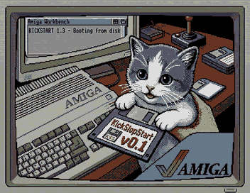

# KickSlopStart — a clean-room Kickstart 1.3 for the Amiga 500

*[Version française](README.fr.md)*

<p align="center"></p>

KickSlopStart is an open-source reimplementation of the Amiga **Kickstart 1.3** ROM (34.5), written from scratch in
68000 assembly using **clean-room** methods. The image is **256 KiB, loaded at `$FC0000`** and runs on a plain
**68000**. It is meant as a drop-in replacement for the original Kickstart on the A500/A1000/A2000. It boots in
emulators, and on a real A500 from the soft-kick disk below; booting it from an EPROM is a later goal.

This repository contains **no Commodore code** and does **not** ship the original ROM. Because the code was written
with an LLM that may have seen leaked Kickstart sources, this claim is checked by measurement rather than taken on
trust: see the [clean-room audit](docs/AUDIT.md) (binary comparison with the 1.3 ROM, source comparison with AROS,
review of the analysis notes, and the list of ROM data deliberately kept for compatibility).

## Download

Ready-to-use ROM images are published on the [Releases](https://github.com/Thaolia/KickSlopStart/releases) page. Each
image is built from the tagged source by a GitHub workflow (`.github/workflows/release.yml`, pinned toolchain), so it is
byte-identical to a local `make kick-prod` of the same commit; its SHA-256 is listed in the release notes. To publish a
new release, push a tag: `git tag v0.1.0 && git push origin v0.1.0`.

## Identifying the ROM

Emulators and tools can recognise any KickSlopStart image, past releases excepted (v0.2.10 and earlier have no ID
block), without a hash list. This layout is stable:

| Offset | Bytes | Content |
|---|---|---|
| `$0C` | 4 | `$0022 $0005`: version 34.5, as on Kickstart 1.3 (programs check it; it is not our release number) |
| `$18` | 4 | ASCII `KSS!`: the fingerprint |
| `$1C` | 64 | NUL-terminated ASCII string, e.g. `KickSlopStart v0.2.11`: the release tag, or the short commit hash for an untagged build (`git describe` for a local one) |

The same block sits at the start of the image on the soft-kick disk. The rest of the header and the checksum are
those of a normal 256 KB Kickstart.

## Try it in your browser

**[Run KickSlopStart in vAmigaWeb](https://vamigaweb.github.io/#%7B%22kickstart_rom_url%22%3A%22https%3A%2F%2Fraw.githubusercontent.com%2FThaolia%2FKickSlopStart%2From%2FKickSlopStart.rom%22%2C%22mouse%22%3Atrue%2C%22startup_script%22%3A%22%28function%20t%28%29%7Btry%7Bif%28%21required_roms_loaded%29throw%200%3Bset_activity_monitor%28true%29%3Bset_memview_enabled%28true%29%3Bmemview_open_panel%28%29%3B%7Dcatch%28e%29%7BsetTimeout%28t%2C500%29%3B%7D%7D%29%28%29%3B%22%7D)**: the browser Amiga emulator starts with the latest released ROM instead of
its own. With no disk it stops on the insert-disk screen; insert an ADF of your own from vAmigaWeb's disk menu or by
dropping it on the window. The link passes the ROM through vAmigaWeb's `kickstart_rom_url` setting
(`https://vamigaweb.github.io/#{"kickstart_rom_url":"…"}`, URL-encoded); it also puts the mouse on game port 1
(`"mouse":true`) and, through a `startup_script`, turns on the activity monitor and opens the live memory view once
the emulator runs. The ROM comes from the `rom` branch
(`KickSlopStart.rom`), which the release workflow updates at each tag: browsers only let vAmigaWeb fetch a file that
is served with a CORS header, which `raw.githubusercontent.com` sends and release downloads do not.

## Soft-kick disk (no ROM swap)

**Minimum: 512 KiB chip RAM + 512 KiB slow RAM** (an A500 with its A501 trapdoor expansion). The `.adf` cannot run
KickSlopStart without the slow RAM, since it lives there. Tested on a real A500.

Each release also comes with `KickSlopStart-<version>.adf`, and the `rom` branch carries the latest one as
[`KickSlopStart.adf`](https://raw.githubusercontent.com/Thaolia/KickSlopStart/rom/KickSlopStart.adf). Boot it on an
Amiga 500 that keeps its own Kickstart 1.3 and has 512 KiB of slow RAM at `$C00000` (A501 trapdoor expansion): its
bootblock loads KickSlopStart into the first 256 KiB of that RAM and starts it, and the remaining slow RAM stays
available. KickSlopStart then shows its insert-disk screen: take the soft-kick disk out and insert the disk you want,
and it boots it. A reset (Ctrl+Amiga+Amiga) comes back to KickSlopStart, through the ColdCapture vector that the Kickstart
in ROM calls at reset; switching the machine off returns to the Kickstart in ROM. Without slow RAM, the disk boots
normally on the Kickstart in ROM. Build it with `make adf` (`build/KickSlopStart.adf`).

## What works

All results below come from booting the ROM in an emulator (FS-UAE, and WinUAE in cycle-exact A500 mode), with
screenshots or serial output as evidence.

- **exec**: the full V34 function table, a preemptive scheduler, user-mode tasks, interrupt servers, resident
  modules, libraries and devices, semaphores and a memory allocator.
- **Devices and resources**: trackdisk (read and write, interrupt-driven DMA, internal DF0 and external DF1), timer
  (VBLANK and MICROHZ), keyboard, input, console, gameport (mouse), audio, cia, disk, misc, potgo, keymap (US and
  French AZERTY), expansion (Zorro II autoconfig), romboot.
- **Graphics**: graphics.library (views, copper lists, blitter, text, regions, GELs) and layers.library.
- **Intuition**: screens, windows with 1.3-style frames, gadgets (boolean, proportional), menus, requesters,
  AutoRequest, Preferences.
- **AmigaDOS**: dos.library with a BCPL runtime, an OFS filesystem handler (read and write), LoadSeg, the CLI and
  shell, RAM:, PIPE:, AUX:, NEWCON:, a disk validator, and booting from a UAE hard disk (DH0:).
- **Workbench 1.3.3** boots to its desktop: disk and drawer icons, Shell, menus, Info, Duplicate/DiskCopy, Clean Up
  and Preferences all work.
- **Software tested**: SetPatch 1.38, Ed, SysInfo, Holiday Lemmings (playable), Caesar, SimCity 1.2, The Secret of Monkey
  Island (disk 1), Scooby-Doo and Scrappy-Doo.

Known gaps and the detailed roadmap are in [`docs/PLAN.md`](docs/PLAN.md).

## Deliberate differences (not bugs)

A few things look different from the original Kickstart 1.3 on purpose. Please don't report them as bugs (see
[issue #5](https://github.com/Thaolia/KickSlopStart/issues/5)):

- **Colours**: the Workbench screen is apple green with black text instead of blue. I like that colour, and it shows
  at a glance which Kickstart is running.
- **Boot screen**: instead of the hand holding a floppy, a kitten holds a "KickSlopStart" disk, because I love cats.
  This is the image as the ROM draws it (the photo at the top of this page is the original artwork):

  <p align="center"></p>

- **Menus**: the check mark is a cat's paw print, and the Amiga-key symbol of keyboard shortcuts is a small cat.
- **Startup window**: the boot CLI window is called "AmigaSlopDOS".
- **Mouse pointer**: the ROM's own pointer is a different arrow from the original, filled in dark purple instead of
  red. A Workbench disk still shows the pointer stored in its `devs:system-configuration`, as on the original 1.3.

## Reporting a problem

Bug reports and compatibility reports are welcome as [GitHub issues](https://github.com/Thaolia/KickSlopStart/issues/new/choose).
The [reporting guide](docs/ISSUE.md) lists what to include (ROM version, emulator and memory configuration,
program, screenshot) and what must never be attached (the original ROM, its disassembly, Commodore sources).

## Why this project, and reusing it

For me this is an **educational project**: a way to learn how AmigaOS 1.3 works from the inside, and to see how far a
clean-room reimplementation written with an LLM can go when every step has to be proven in an emulator.

You are welcome to take it and **make your own Kickstart**. Change the colours, swap the cat for your own pet, add
features or fix compatibility. The code is under the MIT License, and the clean-room audit tools in `tests/` let you
check your own changes the same way.

## Clean-room method

The work is split into two tracks that never mix (see [`docs/CLEANROOM.md`](docs/CLEANROOM.md)):

- **Analysis track**: observes the original ROM (disassembly, probes, debugger) and writes **behaviour and ABI
  descriptions only** to [`docs/analysis/`](docs/analysis/). No instruction sequences are ever copied.
- **Implementation track**: writes `src/` from public documentation (RKRM, NDK, AutoDocs, `.fd` files), AROS as a
  read-only reference, and the analysis specs. It never reads the ROM or its disassembly.

## Building

Requirements, all in the `PATH`:

- `vasmm68k_mot` and `vlink` (Frank Wille's assembler and linker, built from source)
- `romtool` (from [amitools](https://github.com/cnvogelg/amitools))
- `python3`

Installation instructions are in [`docs/HARDWARE.md`](docs/HARDWARE.md).

```sh
make             # build/kick13.rom       development ROM (includes the self-test harness)
make kick-prod   # build/kick13-prod.rom  production ROM (-DPROD=1, no test harness)
make verify      # checks the size (256 KiB) and that romtool reports is_kick = ok
make adf         # build/KickSlopStart.adf soft-kick disk (image linked at $C00000, -DRAMKICK=1)
```

Use `build/kick13-prod.rom` for everyday use in an emulator. The development ROM also runs demo tasks and test
probes during boot.

For a French AZERTY keymap, set `KEYMAP_AZERTY` to 1 in `src/exec/exec.i` before building.

## Testing

The tests boot the ROM headless under Xvfb and check serial markers or screenshots. They need `fs-uae`, `Xvfb`,
`socat`, `xwd` and ImageMagick.

```sh
tests/boot_test.sh                       # boots FS-UAE and checks the serial log
WINUAE=/path/to/AppRun tests/adf_suite_winuae.sh build/kick13-prod.rom 120
                                         # boots every ADF in assets/test_adf/ in WinUAE (cycle-exact A500)
```

`tests/adf_suite_winuae.sh` looks for WinUAE in the `WINUAE` variable, or as `winuae` in the `PATH`. You supply the
disk images yourself; they are not included.

## Repository layout

```
src/exec/        exec.library, devices and resources
src/graphics/    graphics.library, layers.library, boot screen
src/intuition/   intuition.library
src/dos/         dos.library, handlers, CLI/shell, Workbench
src/rom/         ROM packer (padding, footer, checksum) and the M0 hello ROM
src/softkick/    soft-kick disk: loader bootblock and ADF builder
docs/            plan, architecture, hardware/toolchain, clean-room rules
docs/analysis/   specs written by the analysis track
tests/           emulator harnesses and test programs
assets/          boot screen image; your own ROM and ADF files go here (git-ignored)
```

## Legal

- The original Kickstart ROM is copyrighted. It is **not** included and must never be committed. For analysis and
  comparison, put your own copy of `kick34005.A500` in `assets/`; it is git-ignored.
- Game and Workbench disk images are not included either.
- AROS is consulted as a reference only; none of its code is copied into `src/` (measured in
  [docs/audit/aros-similarity.md](docs/audit/aros-similarity.md)).
- Amiga is a trademark of its respective owner. This project is not affiliated with it.

## License

The code in this repository is released under the [MIT License](LICENSE). This covers only the files in this
repository; it grants no rights over the original Kickstart ROM, AmigaOS or any disk image.
